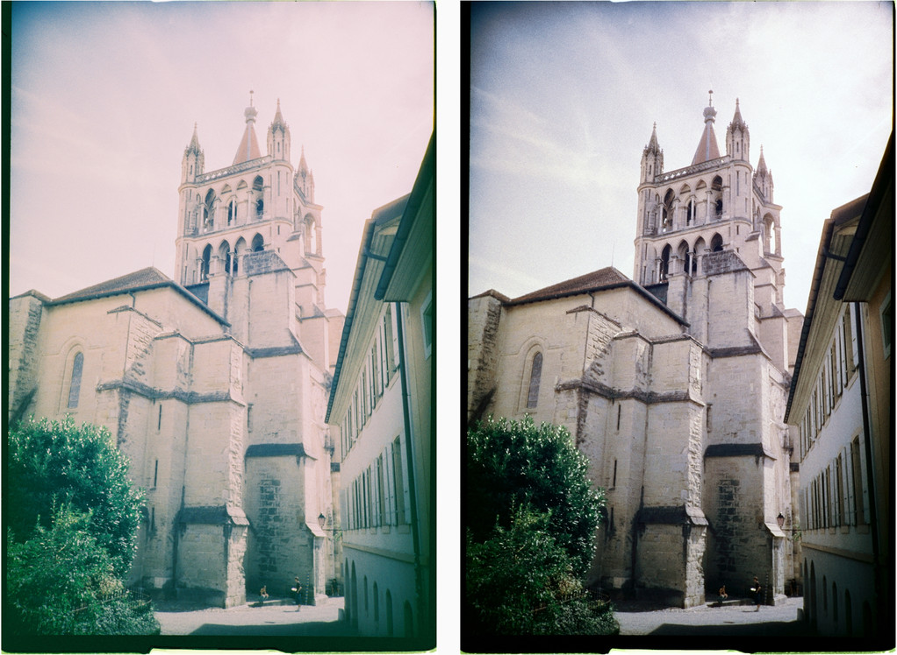
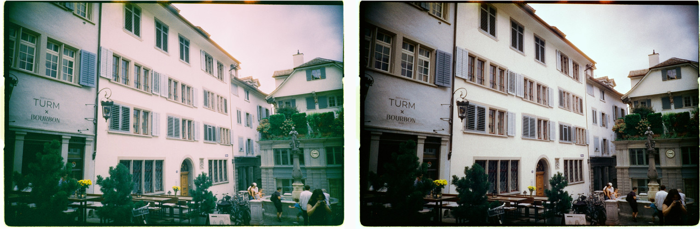
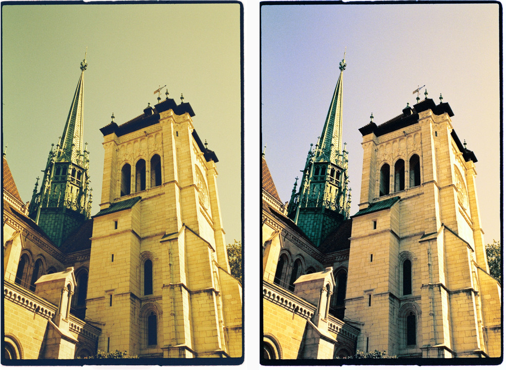
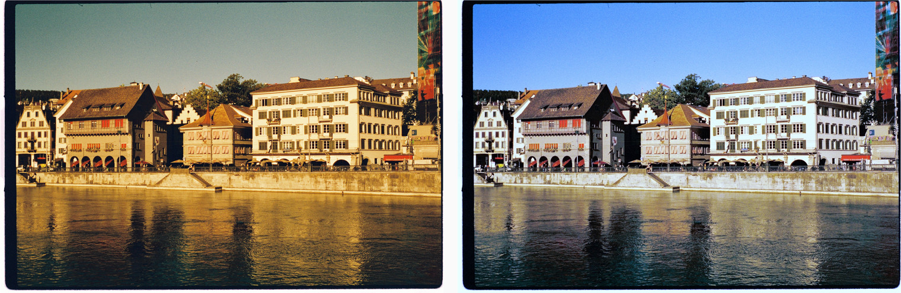

# Film Scan Correction Toolkit

A command-line tool for fixing colour casts, flat contrast and colour noise in
lab scans of colour negative and black and white film.

Labs don't always have a scanning profile for the film you've shot. Using a
profile for another stock can leave the scans washed out or with odd colours.
This toolkit corrects those scans using a profile for the film. It measures the
whole roll first, then adjusts each frame.

## Install

You'll need Ruby 4.0 or later, Bundler and [libvips](https://www.libvips.org/).
Install libvips with your package manager (`brew install vips` on macOS), then
run this from the project directory:

```sh
bundle install
```

## Usage

Put the scans from one roll in a folder and choose a film profile:

```sh
bundle exec ./bin/filmscan --profile lomochrome-color-92 ~/scans/my-roll
```

It reads TIFF, JPEG and PNG files. Corrected copies go to
`~/scans/my-roll - corrected`, using the same file format as the originals.
The originals are left alone. The output folder also gets a `settings.yml`
with the settings used for the run, and a `roll-fit.yml` with what was
measured across the roll. A copy of the measurements is kept in
`~/.cache/film_scan`, so correcting the same roll again with the same settings,
into any folder, skips measuring it.

For previews and a contact sheet:

```sh
bundle exec ./bin/filmscan --profile lomochrome-color-92 \
  --previews --contact-sheet --gentle ~/scans/my-roll
```

Some useful options:

| Option | What it does |
| --- | --- |
| `--out DIR` | Choose the output folder. |
| `--previews` | Save 1600px JPEG previews in a `preview/` subfolder. |
| `--contact-sheet` | Save a numbered contact sheet as `contact.jpg`. |
| `--gentle` | Use half the CPU cores at low priority. |
| `--threads N` | Set the number of threads used for image processing. |
| `--only GLOB` | Process matching frames, e.g. `--only '0000[45]*'`. |
| `--explain` | Report the scan problems detected in the roll, without writing images. |
| `--audit` | Also report how the chosen profile handles those problems. |
| `--overrides FILE` | Load per-frame settings from YAML, keyed by filename without its extension. |
| `--convert-only` | Just change the file format, no correction. No profile needed. |
| `--crop` | Remove the film borders. They stay by default. |
| `--match DIR` | Balance toward a roll that already looks right. See below. |

By default, image processing uses all CPU cores. Command-line settings override
the profile. Run `bundle exec ./bin/filmscan --help` for the full list, including
colour, contrast and grain controls.

## Frames that come out sideways

Labs tag portrait frames with an orientation, and each corrected frame is
written upright from it. When the lab missed a frame or tagged it the wrong
way, give that frame an orientation in the overrides file, numbered as EXIF
numbers them: 1 leaves it as scanned, 3 turns it upside down, 6 a quarter turn
clockwise and 8 a quarter turn anticlockwise.

```yaml
"000045":
  orientation: 8
```

The sky detection and the roll's measurements see the frame the same way up as
the written file. A contact sheet shows every frame the way it will be written,
so it is the quickest place to spot one that needs this.

`--orient` looks for such frames and prints overrides to paste in. It changes
nothing itself:

```sh
bundle exec ./bin/filmscan --orient --overrides overrides.yml ~/scans/my-roll
```

It asks a small pretrained network which way up each frame looks. A suggestion
is printed ready to paste only when the network gives the same answer however
the frame is turned first, the lab left the frame untagged, and the answer
turns it the way the roll's other portraits go. Anything else it found is
printed commented out, with the reason, for a look first. With
`--contact-sheet` it also draws those frames as written and as suggested in
`orientation.jpg`. Ceilings and other frames shot straight up have no up for it
to find.

It needs the optional `onnxruntime` gem, which comes prebuilt for macOS, Linux
and Windows. Run through `bundle exec`, it is installed with:

```sh
bundle config set --local with orient
bundle install
```

Run as `./bin/filmscan` on its own, `gem install onnxruntime` does it.

The network ([deep-image-orientation-detection](https://huggingface.co/DuarteBarbosa/deep-image-orientation-detection),
MIT licence, 81 MB) is downloaded once into `~/.cache/film_scan/models` and
checked against its digest.

## Matching another roll

The profiles balance each film toward FujiFilm Superia in general. If you shot
another roll the same day that the lab scanned well, you can match that instead:

```sh
bundle exec ./bin/filmscan --profile harman-phoenix-200 \
  --match ~/scans/fuji-same-day ~/scans/phoenix-roll
```

Besides the colour of greys, it carries over how light the matched frames are,
their colour at each brightness and how colourful they are. Deep shadows keep
their own colour, since an interior has nothing to learn from sunlit streets.
`--match-strength 0.6` carries over less of it.

Give `--match` once for each roll, or a quoted pattern for some of its frames,
such as `--match '~/scans/fuji/00005*.tif'`. It works best when both rolls saw
the same kind of light and subjects. The measured reference is saved as
`match-reference.yml` in the output folder and reused on the next run.

## Output formats

Use `--format` to choose `tiff`, `jpeg`, `png`, `heic` or `jp2`:

```sh
bundle exec ./bin/filmscan --profile lucky-shd-400 \
  --format tiff --bits 16 ~/scans/my-roll
```

TIFF, PNG and JPEG 2000 default to 16 bits per channel, HEIC to 10 and JPEG
to 8. Use `--bits` to change the depth where the format supports it. Eight-bit
output is dithered to reduce banding in gradients.

`--quality` defaults to 98. Setting it to 100 produces lossless HEIC or JPEG
2000 output. Support for these formats depends on your libvips build.

HEIC is written with libheif's `heif-enc` (installed alongside libvips by
Homebrew), at full colour resolution and as true greyscale for black and
white. Without it, HEIC falls back to 8 bits through libvips. If your libvips
build can't read the resulting HEIC files back, `--previews` gives you JPEGs
to browse.

### Apple's hardware encoder (macOS, optional)

On a Mac with Apple silicon, `--encoder apple` writes HEIC with the hardware
HEVC encoder instead of x265. The files are the same kind: 10-bit 4:4:4,
written as a grid of 2048px tiles that libheif, libvips and macOS all open.
On the frames tested it was five to seven times faster than x265 and used
almost no CPU. The files were 15 to 19% larger at the same quality setting,
with slightly higher fidelity. It needs a small helper, built once with
Xcode's command line tools (macOS 13 or later):

```sh
bundle exec rake apple_heic
```

Without the helper, `--encoder apple` stops and says how to build it. x265
stays the default, and some frames still go to it:

- black and white, since Apple's decoder reads the hardware's monochrome a
  level off grey;
- lossless (`--quality 100`), and 8 or 12 bits;
- any frame denser or noisier than the hardware encoder has been tested on.

That last check matters. In testing, a frame of pure noise hung the hardware
encoder and the Mac's kernel panicked. So the helper measures every frame
before the encoder sees it, and hands it to x265 if its densest tile would
need more than 1.85 bytes a pixel, or if it has less detail than 0.35 times
its grain. Those limits are 10% short of the densest and the grainiest of 31
real frames that encoded cleanly: corrected, matched and unprocessed scans
from 0.5 to 2.1 bytes a pixel. On the rolls they came from, about one colour
frame in 300 goes to x265. The hardware encoder's real limit is unproven
beyond those frames.

Installing the gem never needs a compiler. A macOS platform gem could carry
the helper prebuilt: build it with `rake apple_heic` on arm64, add
`libexec/apple-heic` to the gem's files and set its platform to
`arm64-darwin`.

### Metal engine (macOS, optional)

`--engine apple` works out each frame's colour on the GPU. The correction is
the same Ruby code either way: under this engine the per-pixel steps it asks
libvips for are gathered into Metal kernels, one per run of steps, and the
blurs run on the GPU with libvips' own masks. Whatever the engine does not
cover (resizing, measuring, the roll analysis) still goes to libvips.

Frames match the libvips engine to within float rounding. On four Lucky SHD
frames, about one pixel in a hundred moved by one level in ten bits, and a
few thousand at the very edge of the scan moved by up to four. On 20 frames
of the same roll, written as HEIC with `--encoder apple`, a run took 59
seconds and 125 seconds of CPU, against 164 seconds and 2,161 with libvips.
With x265 the GPU is waiting on the encoder, and a run is about twice as
fast. It needs a small library, built once (macOS 15 or later):

```sh
bundle exec rake apple_engine
```

Once it is built, it is the default on that Mac, and `--engine vips` goes
back to libvips. Without it, libvips is the default and `--engine apple`
stops and says how to build it.

## Extra fixes

The film profiles handle colour and tone. Use `--fix` to also recover shadows
and highlights, or sharpen soft frames:

```sh
bundle exec ./bin/filmscan --profile lucky-shd-400 \
  --fix floor,shadows ~/scans/my-roll
```

`--fix` on its own enables the default set. `--fix all` enables every available
fix, or you can pass a comma-separated list:

| Fix | What it does |
| --- | --- |
| `floor` | Use the film border to estimate the frame's black level. |
| `flat` | Lift dark corners. Also needs a nonzero `--flat-field` setting. |
| `shadows` | Recover shadow and highlight detail where possible. |
| `sharpen` | Sharpen frames that measure as soft. |
| `grain` | Adjust colour noise reduction to the frame's measured grain. |

`floor` needs visible film borders. If the lab already cropped them off, it is
skipped. Corner correction is disabled in all bundled
profiles because it can add coloured halos to skies.

## Supported films

The examples below show the original scan on the left and the corrected version
on the right.

### LomoChrome Color '92 (`lomochrome-color-92`)

Corrects colour casts, weak saturation, flat contrast and magenta colour noise.


### Harman Phoenix I 200 (`harman-phoenix-200`)

Corrects green shadows, pink highlights and washed-out tones, using Fujifilm
Superia as a reference for colour balance and contrast.





### Lucky SHD 400 (`lucky-shd-400`)

Corrects the strong yellow cast caused by weak blue midtones, with extra colour
correction for warm subjects and bright skies.





### Black and white (`black-and-white`)

For HP5, Kentmere, Foma, Lady Grey and other black and white film scanned in
colour. Removes the scan's tint, sets the black and white points, adds a
little contrast and saves a greyscale file.

## Custom profiles

Profiles are YAML files in [profiles/](profiles/). To try another film, copy an
existing profile, adjust its settings and pass the file path:

```sh
bundle exec ./bin/filmscan --profile ./my-film.yml ~/scans/my-roll
```

The bundled profiles use [Fujifilm Superia](references/fujifilm-superia.yml) as
a reference, measured from seven rolls of Superia 200 and 400. The toolkit
compares neutral colours at different brightness levels, corrects the film's
measured cast, then adjusts for differences between rolls and individual frames.
Profiles can also use the reference's tonal distribution to adjust contrast.

<details>
<summary>Measuring a reference or film profile</summary>

To make a reference from rolls that your lab scans well:

```sh
bundle exec ruby tools/measure_reference.rb my-film "My Film 400" \
  ~/scans/reference-roll1 ~/scans/reference-roll2
```

This writes `references/my-film.yml`. Set `reference: my-film` in a profile, or
pass `--reference my-film` when running the toolkit.

To measure a film's colour cast, use several rolls with varied subjects:

```sh
bundle exec ruby tools/measure_film.rb lucky-shd-400 \
  ~/scans/roll1 ~/scans/roll2 ~/scans/roll3
```

This updates `film_gains` in the profile. To measure colour differences that
remain after that correction:

```sh
bundle exec ruby tools/measure_shape.rb lucky-shd-400 \
  --reference ~/scans/superia-roll ~/scans/lucky-roll
```

This updates `chroma_map` in the profile; `chroma_shape` controls its strength.
Both measurement tools edit the profile in `profiles/`.

</details>

## Tests

```sh
bundle exec rake
```

## Licence

[PolyForm Noncommercial 1.0.0](LICENSE.md). Free to use, modify and share for
non-commercial purposes.
